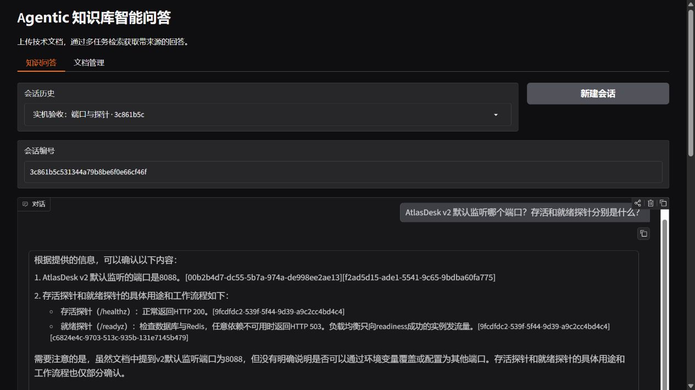
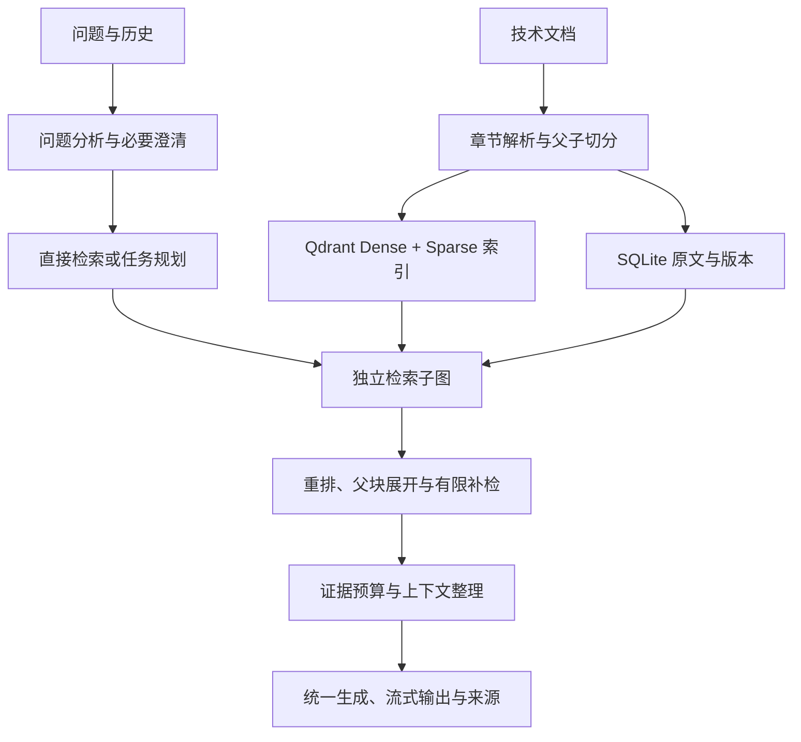

# Agentic 知识库智能问答系统

面向技术文档问答的个人学习与实践项目。使用 LangGraph 组织主图与独立检索子图，将问题分析、任务拆解、混合检索、证据审核和上下文管理串成可追溯的问答流程。

**技术栈：** Python · LangGraph · Qdrant · BGE-M3 · BGE Reranker · Ollama · Gradio · SQLite



> 截图为演示资料上的单次问答展示，不代表完整评测成绩。项目定位为本地单用户、多会话系统。

## 核心功能

- **文档管理：** 解析 Markdown、TXT、文字型 PDF 和 DOCX，保存章节或页码；支持同名文档版本更新、删除和原文追溯。
- **混合检索：** 递归字符父子切分，BGE-M3 Dense + Sparse 双路召回，Qdrant RRF 融合，Cross-Encoder 重排与父块展开。这里的 Sparse 是 BGE-M3 学习式稀疏向量。
- **分层 Agent 流程：** 简单问题直接检索，复杂问题由规划与校验逻辑拆为最多 4 个任务，通过 Send 派发至独立子图；支持最多两波依赖调度与有限补检。
- **澄清与恢复：** 缺少必要范围时在 clarify 节点前暂停，通过 SQLite 检查点与同一 thread_id 恢复。
- **上下文管理：** 保留连续的近期对话，将旧历史累计为结构化摘要；在 token 预算内整理逐字证据摘录并保留来源。
- **交互与评测：** Gradio 多会话、流式回答、引用原文，以及独立环境下的 RAGAS 评测和检索消融入口。

## 流程概览



详细状态流和实现边界见 [架构说明](docs/ARCHITECTURE.md)。默认低内存配置的重模型执行并发为 1；Send 派发能力本身不代表已经验证并行提速。

## Windows 快速启动

需要 Python 3.11–3.13、[uv](https://docs.astral.sh/uv/) 和 [Ollama](https://ollama.com/)。首次安装真实模型需要联网下载，并预留模型存储空间；CPU 环境可以运行，但生成和评测可能较慢。

```powershell
git clone https://github.com/shuiha-99/Agentic-Knowledge-Base.git
cd Agentic-Knowledge-Base

# 创建主环境并安装真实模型依赖；同时生成 .env
.\scripts\setup.ps1 -WithModels

# 编辑 .env，把 KB_OLLAMA_EXECUTABLE 设置为本机 Ollama 程序路径
# 独立服务默认使用 11435 端口
.\.venv\Scripts\python.exe -m agentic_kb doctor
.\.venv\Scripts\python.exe -m agentic_kb start-ollama
.\.venv\Scripts\python.exe -m agentic_kb prepare-models

# 导入虚构演示资料，启动界面
.\.venv\Scripts\python.exe -m agentic_kb ingest data\demo_docs
.\scripts\start.ps1 -OpenBrowser
```

界面地址为 `http://127.0.0.1:7860`，准备完成后也可以双击 `start.cmd` 启动。Qdrant 默认采用嵌入式存储，无需 Docker；可通过 `KB_QDRANT_URL` 连接独立服务。

默认生成模型为 `qwen2.5:7b`，可选 `qwen2.5:3b` 辅助模型仅处理配置白名单内的摘要等结构化任务。检索模型为 `BAAI/bge-m3`，重排模型为 `BAAI/bge-reranker-v2-m3`。模型、索引、会话与实验记录均存放在本地 `runtime/`，不随仓库上传。

更多安装、低内存设置及修改源码后的刷新方法见 [操作说明](docs/OPERATIONS.md)。

## 测试与评测

```powershell
# 不依赖真实模型的控制流与组件回归
.\.venv\Scripts\python.exe -m pytest -q
.\.venv\Scripts\python.exe -m ruff check src tests scripts

# 不下载模型的界面流程演示，会明确标注测试模式
.\.venv\Scripts\python.exe -m agentic_kb ingest data\demo_docs --offline-test
.\scripts\start.ps1 -OfflineTest

# 可选：建立独立 RAGAS 环境并执行真实模型评测
.\scripts\setup.ps1 -WithModels -WithEvaluation
.\.venv-ragas\Scripts\python.exe scripts\ragas_worker.py --check
.\.venv\Scripts\python.exe -m agentic_kb evaluate --mode agent --ragas
```

演示知识库为虚构的 AtlasDesk 星河工单服务，共 32 份资料。演示评测集为 120 题、44 个语义问题族，按族划分为 32 题开发集和 88 题测试集，属于 AI 辅助构建与原文锚点检查的数据，不是独立人工标注的企业测试集。

控制流测试中的模型替身不用于生成质量成绩。完整、重复的问答质量评测尚未完成，本仓库不宣称既定准确率、稳定压缩效果或生产性能。检索 Recall、ContextRecall、Faithfulness 和 AnswerCorrectness 的含义不同，不能互相替代；失败与未开始项需要单独报告。

具体口径见 [评测说明](docs/EVALUATION.md) 和 [数据集审阅](docs/DATASET_REVIEW.md)。

## 项目结构

```text
src/agentic_kb/  文档解析、检索、图编排、上下文、界面与评测
scripts/        环境准备、启动、验证与评分脚本
tests/          控制流、组件与集成回归
data/demo_docs/ 虚构演示文档
data/eval/      演示问答与长对话评测数据
docs/           架构、操作、验收及评测说明
```

## 已知边界

- 当前面向本地单用户使用，企业权限、分布式部署和生产级性能尚未实现或验证。
- 扫描 PDF 需要另行 OCR；DOCX 按标题与段落定位，不生成虚构页码。
- 引用校验检查来源标识，不能保证每句回答都受到证据支持。
- 上下文压缩可能丢失条件；缩短 token 数不等于无损，也不等于同等比例的延迟或成本下降。
- 文档身份按不区分大小写的文件名确定；需要保留两个同名文件时应先重命名。

依赖库、第三方模型的使用分别遵循其各自许可证与模型条款。项目验收映射见 [ACCEPTANCE.md](docs/ACCEPTANCE.md)。
