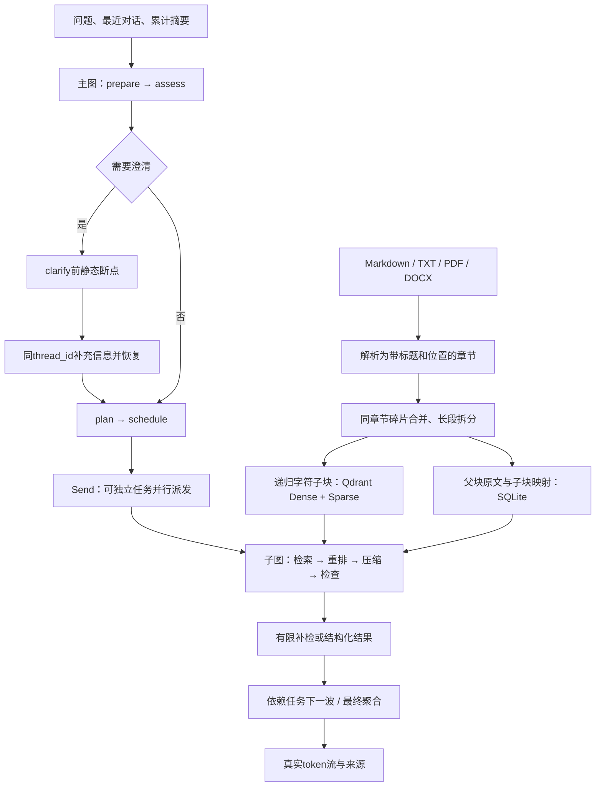

# 实现架构

项目面向本地单用户、多会话的技术文档问答。演示知识库为虚构的 AtlasDesk 星河工单资料，不能作为真实企业运行证明。生成模型由 Ollama 运行；文档向量和重排采用独立的真实模型适配器。

## 两条链路

## 文档和索引

章节边界保留标题层级，PDF 保留实际页码，DOCX 使用段落与标题位置，不伪造排版页码。扫描 PDF 未包含可提取文字时，需要用户先进行 OCR。

切块长度的单位是**字符**：父块默认1600、子块420、重叠分别100与60。实现采用 `RecursiveCharacterTextSplitter`，优先段落、换行和中英文标点，再退化为字符边界。父块内的过短段落按规则合并，不能跨不同章节拼接。模型输入预算另用生成模型分词器计算 token，两者不可混称。

Qdrant保存子块及Dense、Sparse命名向量。BGE-M3同时生成语义向量和学习式稀疏权重；Sparse不是把Dense向量另起一个名称。两路召回经RRF融合，再由Cross-Encoder排序，按模式决定是否展开父块。

文档逻辑ID以文件名确定，因此同名上传代表更新；字节哈希用于内容去重。SQLite记录已激活版本，查询只读取当前激活的文档版本。新索引准备失败时不能把半成品激活。原始上传内容保存在受管目录，避免临时上传文件消失后来源失效。

## 图的状态边界

主图拥有完整会话、累计摘要、当前问题、计划、各任务结果、最终答案。子图只接收单个 `RetrievalTask`、明确约束和必要的前置任务结果；子图私有检索历史不会成为其他并行子图的消息历史。

规划节点根据问题生成受校验的任务列表。`Send`负责派发，本身不负责理解和拆题。独立任务并行，有依赖的任务在前置结果完成后进入下一波；任务数、波数、检索次数、单任务时间与总运行时间均有上限。结果以任务ID合并，避免并发写入覆盖。

查询分析结合结构化模型与一致性检查：首轮保留用户原问题，多轮才采用历史指代改写；澄清字段限定为实体、版本、环境等范围，不能要求用户提供本应检索的业务答案。显式提供版本时会检查冗余版本追问；两个明确版本的对比也会进入规划器，补偿分析模型漏报拆解的情况。实际任务仍由模型规划并校验，不按测试集题型或参考答案分支。

默认`evidence_review_policy=complex`：简单问题直接检索与最终生成，跳过规划和独立完整性审核；记录明确标为`skipped/partial`。复杂任务执行有上限的审核和补检。没有为每个子任务另作文本生成，依赖任务传递带来源的逐字证据包，最终统一聚合。

澄清严格使用 `interrupt_before=["clarify"]`：只有歧义路由会进入此节点；用户回答写回同一个检查点，再继续执行。SQLite检查点与稳定thread_id构成暂停恢复基础。UI显示历史保存在另一张会话数据库中，加载时检查真正的图暂停状态。

## 上下文预算

全局记忆保存用户目标、约束、实体、已确认事实和待解决项；触发时将旧摘要与新增对话累计合并。局部证据只允许逐字摘录已有原文，保留来源ID，原始证据不被覆盖。模型压缩失败会显式降级，并在统计中记录fallback/lossy。

可用预算由模型窗口减去当前固定输入、输出预留和消息开销得到。触发比例、目标比例只是配置；对应token阈值随问题与固定输入变化。每次压缩记录before/after、是否触发、是否估算、是否降级。压缩比例不构成事实保留或回答正确的证明。

## 运行与评测隔离

`provider=ollama`使用真实模型。`offline-test`使用明确命名的规则模型、哈希测试向量和词项重排，仅验证流程、持久化和错误处理；代码禁止其生成RAGAS成绩。测试数据目录与真实模型索引分开，嵌入模型指纹变化时拒绝混用旧向量。

应用采用LangChain 1.x / LangGraph 1.x；原描述的AnswerCorrectness使用锁定的Ragas0.3.3，而该版本引用LangChain0.3旧接口。因此评测放在独立环境，通过常驻JSONL进程通信；应用预先提供真实Dense向量，评测进程不重复加载BGE或Torch。

本地Qdrant路径只允许单进程打开。需要同时运行多个服务进程时使用Qdrant服务端模式，并为不同嵌入配置使用专用集合。当前项目不宣称多租户权限隔离、生产可用性或外部调用恰好一次。
